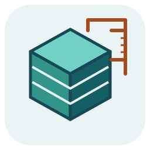

<p align="center">
  
</p>

<h1 align="center">3d-designs</h1>

<p align="center"><strong>Parametric 3D-print designs with ready-to-print Bambu Studio projects.</strong></p>

<p align="center">
  <a href="https://github.com/edbfi/3d-designs/blob/main/LICENSE"></a>
  <a href="https://github.com/gumyr/build123d"></a>
  <a href="https://github.com/openscad/openscad"></a>
  <a href="https://github.com/python/cpython" title="CPython implementation source"></a>
  <a href="https://github.com/edbfi/3d-designs/actions/workflows/ci.yml?query=branch%3Amain"></a>
</p>

My parametric 3D-print designs. Each one is a parametric source you can customise, in build123d or OpenSCAD, plus ready-to-print Bambu Studio projects.

## Designs

| Design | What it is | Path |
|--------|------------|------|
| Streaming-style lettering | Bent streaming-style lettering for a library display: a stand, a plaque, loose wall letters and two pinboard frames | [`streaming-lettering`](streaming-lettering) |
| Q6A fan stand | A stand that holds a Noctua NF-A8 80 mm fan over a Radxa Dragon Q6A in its Armor Case 7056A, with the 40-pin header free | [`q6a-fan-stand`](q6a-fan-stand) |

## Layout

Every design has its own folder, and they share one build toolchain:

```
tools/
├── docker/          # the pinned build toolchain (OpenSCAD, build123d, Bambu Studio) every design builds in
├── openscad         # OpenSCAD from that toolchain, for AI agents' OpenSCAD tooling
└── release.sh       # publishes a design's print files as its GitHub release
<design>/
├── README.md        # what to print, assembly, customising
├── <design>.py      # the parametric source: build123d,
│   or <design>.scad #   or OpenSCAD where MakerWorld's customiser should offer it
├── fonts/           # bundled fonts with their licences, if any
├── docs/            # design notes; build summary and images (generated)
├── templates/       # paper templates, if any (generated)
├── makerworld/      # MakerWorld edition of a .scad, if any (generated)
├── tools/           # the build script that generates the rest
└── build/           # scratch, not in git; build/release/ holds the print files
```

## Print files

A design's print files live in its GitHub release, `<design>-latest`, not in git. One design is one release and one MakerWorld listing. Each `.3mf` is an unsliced Bambu Studio project and one MakerWorld print profile. Files are named:

```
<design>[-<variant>][-<product>]-<printer>.3mf
<design>[-<variant>].step
```

- **product**: one thing printed and photographed as one print profile, such as `stand` or `frame`. Left out when a design has only one.
- **printer**: the Bambu printer the project targets, such as `a1-mini` or `a2l`. A bigger printer gets its own file only when it gets bigger parts or a different plate layout.
- **variant**: only for a variant that fits different hardware, such as another fan or case. Every other variant, such as another word or an optional part, is a plate in the same file.

Plates are named `[<GROUP> ]<part>[ <i> of <n>][ (<note>)]`, for example `SERIER letters` or `Fit test (print first)`. `<GROUP>` is the word or option the plate belongs to, when a file holds several. A fit test is always plate 1.

## Licence

Original code, models and print files in this repository are licensed under the
[GNU Affero General Public License](LICENSE), version 3 or (at your option) any later version
(`AGPL-3.0-or-later`). Bundled fonts keep their own licences (see each design's `fonts/`);
the [streaming-lettering MakerWorld edition](streaming-lettering#licence-and-trademarks)
also remains available under CC BY-SA 4.0.
