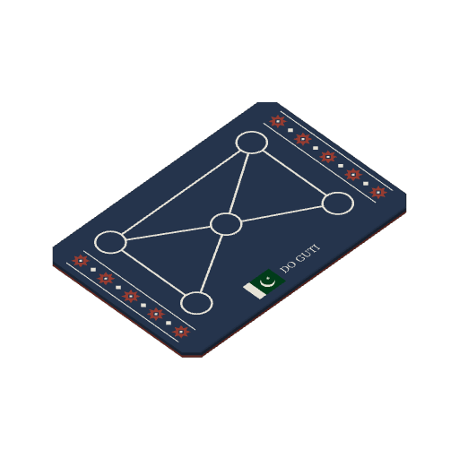

# Do Guti

An Ajrak-inspired board for the two-player blocking game documented in Punjab. Madder rosettes frame an indigo playing surface. Each player has two faceted counters. The red octagons have one dimple and the white counters have two, so the sets can also be distinguished by touch. [Digital Ludeme Project game record](https://ludii.games/details.php?keyword=Do+Guti)

## What to print

Open the projects from `build/release/` in Bambu Studio. Use a 0.4 mm nozzle, the textured PEI plate and the PLA Basic profiles saved in the projects. The top artwork prints flush. The pieces are loose and the set needs no assembly.

| Printer | Project | Filament |
|---|---|---|
| A2L | `do-guti-board-a2l.3mf` | Map the four slots to indigo, madder red, warm white and flag green. |
| A1 mini | `do-guti-counters-a1-mini.3mf` | Print the madder pair on the first plate and the white pair on the second. Each plate uses a single colour. |

For slicer estimates, see the [build summary](docs/build-summary.md).

## How to play

Start with an empty board. Take turns placing one counter on an empty ring until all four counters are down. Then take turns sliding one of your counters along a line to the vacant neighbouring ring. The lower two corners have no direct connection. You win when your opponent has no legal move. [Do Guti rules and historical source](https://ludii.games/data.php?gameId=787)

## Rebuilding and personalising

From this folder, run `../tools/docker/run.sh python3 tools/build.py --jobs 2` for the projects and assembled STEP. Run `cad run do-guti.py` to inspect the playing set in text-to-cad.

For a school edition, put a filled vector outline in `reference/school-mark.svg` and add `--school` to the build command. The board carries the mark in the lower-left margin and the personalised projects and STEP go to `build/school/release/`. The CAD viewer picks up the local artwork when present.

## MakerWorld and licence

The board and counter projects are separate print profiles for the same set. Use the standard build for the public listing. The original design is [AGPL-3.0-or-later](../LICENSE). A school retains the rights to its own mark.
