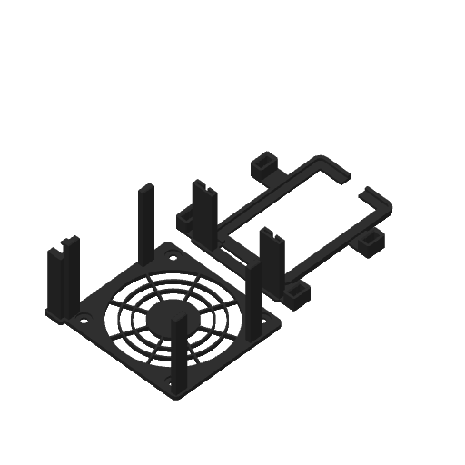

# Q6A fan stand

A stand that holds a Noctua NF-A8 80 mm fan over a Radxa Dragon Q6A in its fanless Radxa Armor Case 7056A. The fan blows down onto the case's fins. The case sits in a base, and a hood carries the fan above it. The hood's four legs plug into the base, so nothing is screwed, glued or clamped to the case, and the whole thing lifts as one unit.



- **Hood:** a top plate with a finger guard over the fan. The fan hangs under it on Noctua's rubber mounts, so its vibration doesn't reach the stand. A cable duct runs down the leg at the header's pin-1 end and ends in a holster for the fan plug.
- **Base:** a flat frame the case drops into, with sockets for the hood's legs. Two upright sleeves at the microSD end hold the Wi-Fi antennas.
- **Clear:** every port and button stays free, including the 40-pin header with jumpers on it, the microSD slot, the power and EDL buttons and the RTC connector under the case. The fan sits 13 mm above the fins, which clears the Dupont jumpers and the motor hub's dead zone.

## What you need

- The printed hood and base, in PETG (see [Material](#material)).
- A Noctua NF-A8 5V PWM and the four NA-AV1 rubber mounts from its box. The fan screws aren't used.
- To control the fan's speed from the board: four male-to-female Dupont jumpers, 10 cm long. 20 cm jumpers work too, but their extra length loops beside the header. Without them, the fan runs at full speed on Noctua's USB adapter.

## Pick a file

Download the project for your printer and open it in Bambu Studio. The printer, plates and filament are already set. Plate 1 is the [fit test](#fit-test): print it first, then the stand's plates. For times and grams, see [`docs/build-summary.md`](docs/build-summary.md).

| Printer | Project | Stand plates |
|---|---|---|
| A1 mini | [`q6a-fan-stand-a1-mini.3mf`](https://github.com/edbfi/3d-designs/releases/download/q6a-fan-stand-latest/q6a-fan-stand-a1-mini.3mf) | Hood, then base |
| A2L | [`q6a-fan-stand-a2l.3mf`](https://github.com/edbfi/3d-designs/releases/download/q6a-fan-stand-latest/q6a-fan-stand-a2l.3mf) | Hood and base together |

Every file uses Bambu PETG Basic, the stock 0.20 mm Standard profile and the textured PEI plate. Nothing needs supports: the hood prints upside down, guard on the bed.

### Material

Print the hood and base in PETG, not PLA: the case stays warm for hours, near the temperature where PLA softens and creeps (numbers in the [design notes](docs/design-notes.md#material)). The fit test can be PLA or PETG, but the fits are tuned for PETG.

## Fit test

The fit test is a short print that checks every fit before you print the real parts. Print it in the filament you'll use for the stand.

| Sample | Check | If it's wrong |
|---|---|---|
| Frame | The case drops in with a little play all round, and doesn't rock. | `FIT` |
| Leg tip and socket | The tip pushes in firmly over the crush ribs and doesn't fall out when you turn it over. | `RIB` (tighter or looser), `FIT` |
| Mount webs, 1 to 5 dimples | An NA-AV1 pulls through and holds the web without tearing. Note which one grips best. 1, 2 and 3 are 1.2, 1.5 and 1.8 mm webs with 4.6 mm holes; 4 and 5 are 1.5 mm webs with 4.3 and 5.0 mm holes. | `AV_WEB`, `AV_HOLE` |
| Antenna sleeve | An antenna slides in, liner on, and its lead passes the slit. | `ANT_FIT`, `ANT_T` |
| Duct bottom | The fan's plug, with the Dupont pins in it, snaps in through the window and stands on the ledge. The fan cable presses through the slot. | `HOLSTER`, `CABLE_D` |

If anything is wrong, change that setting at the top of [`q6a-fan-stand.py`](q6a-fan-stand.py) and rebuild (see [Rebuilding](#rebuilding-the-print-files)).

## Assembly

1. **Fan:** pull the four NA-AV1 mounts through the hood's corner holes from the guard side. Put the fan under the plate with its airflow arrow pointing away from the guard (down onto the case), and turn it so its cable leaves at the corner next to the duct. Pull the mounts through the fan's holes.
2. **Cable:** press the fan cable into the duct's slot, folding any spare length into the duct. If you wire it to the header, push the four Dupont male pins into the fan's plug and snap the plug into the holster at the bottom of the duct.
3. **Base:** set the case in the base: header towards the duct's side, the microSD end towards the antenna sleeves. Slide each antenna into its sleeve, lead down, with the lead through the slit.
4. **Hood:** plug the hood's legs into the sockets, and push the jumpers onto the header.

To reach the header or swap jumpers, pull the hood straight up. The case and antennas stay in the base.

### Wiring to the 40-pin header

| NF-A8 pin (wire) | Signal | Header pin |
|---|---|---|
| 1 (black) | GND | 6 |
| 2 (yellow) | +5 V | 4 |
| 3 (green) | Tach | 18 (GPIO27) |
| 4 (blue) | PWM | 16 (GPIO26) |

Pin 1 is at the microSD end of the header. The header's plastic is colour-coded: pins 2 and 4 are red (5 V) and pin 6 is black (GND). Speed control needs a device-tree overlay that drives GPIO26 as PWM. Without one, leave the PWM wire unconnected and the fan runs at full speed.

## Rebuilding the print files

```bash
../tools/docker/run.sh python3 tools/build.py --jobs 2      # everything; CPUS=2 caps the container lower
../tools/docker/run.sh python3 tools/build.py --jobs 2 --only a1-mini
```

The repo's shared toolchain in [`../tools/docker/`](../tools/docker) pins build123d and Bambu Studio. The script checks the fit against the case and fan, exports the parts, slices every plate with the stock Bambu profiles, and refuses to write a project that fails its checks. It writes the projects and the STEP export to `build/release/`, and the image and [build summary](docs/build-summary.md) to `docs/`. When a Bambu Studio step fails, its log is in `build/work/<project>/`. Once a change is merged, `../tools/release.sh q6a-fan-stand` publishes the [release](https://github.com/edbfi/3d-designs/releases/tag/q6a-fan-stand-latest).

To look at the model while changing it, run `cad run q6a-fan-stand.py` with [text-to-cad](https://texttocad.dev). It opens the hood, the base, the fit test and an assembly with the case and fan in the CAD Viewer.

The measurements and decisions behind the design are in [`docs/design-notes.md`](docs/design-notes.md).

## Licence and trademarks

The model, build script and print files are [AGPL-3.0-or-later](../README.md#licence).

This is an independent design. It isn't affiliated with or endorsed by Radxa or Noctua. Radxa, Dragon and Armor Case are Radxa's trademarks, and Noctua and NF-A8 are Noctua's. The case and board positions come from Radxa's published drawings; none of their files are included.
