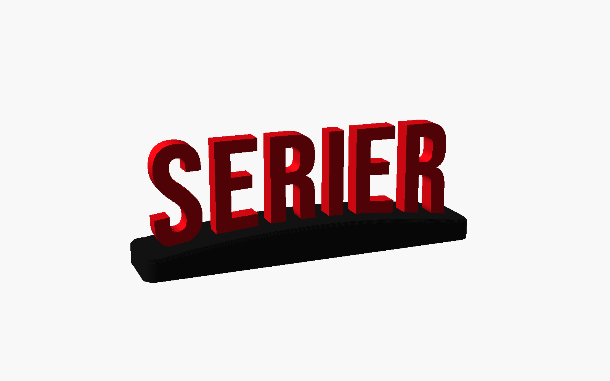
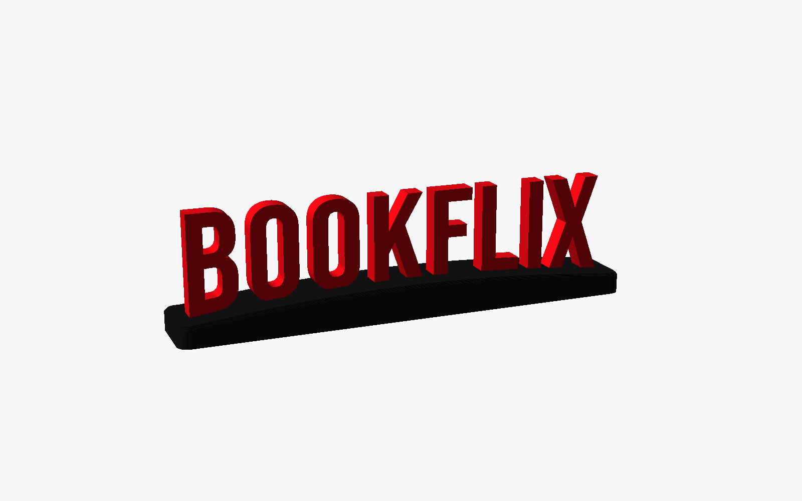
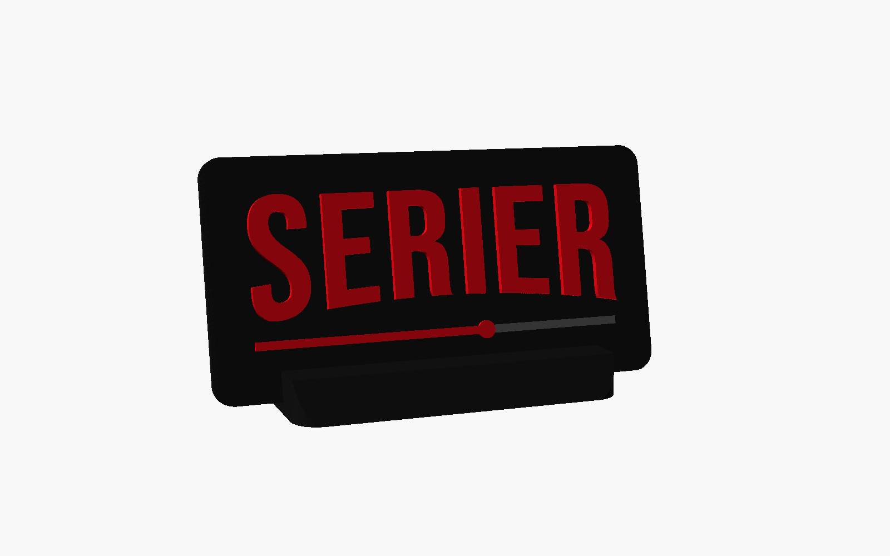
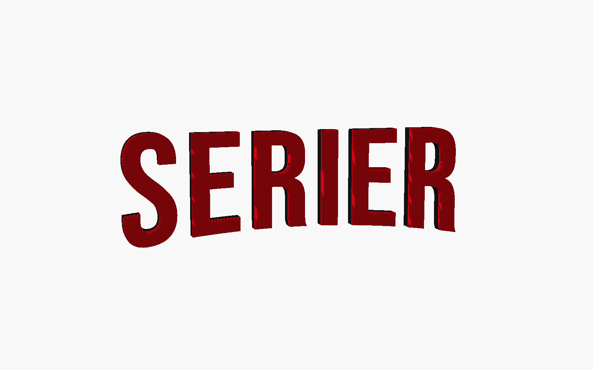
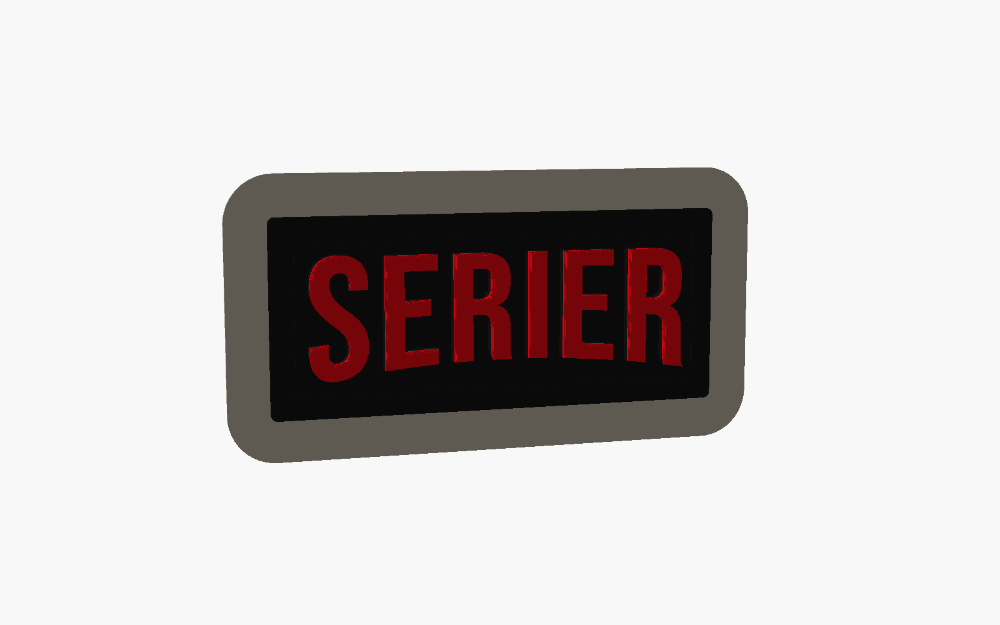
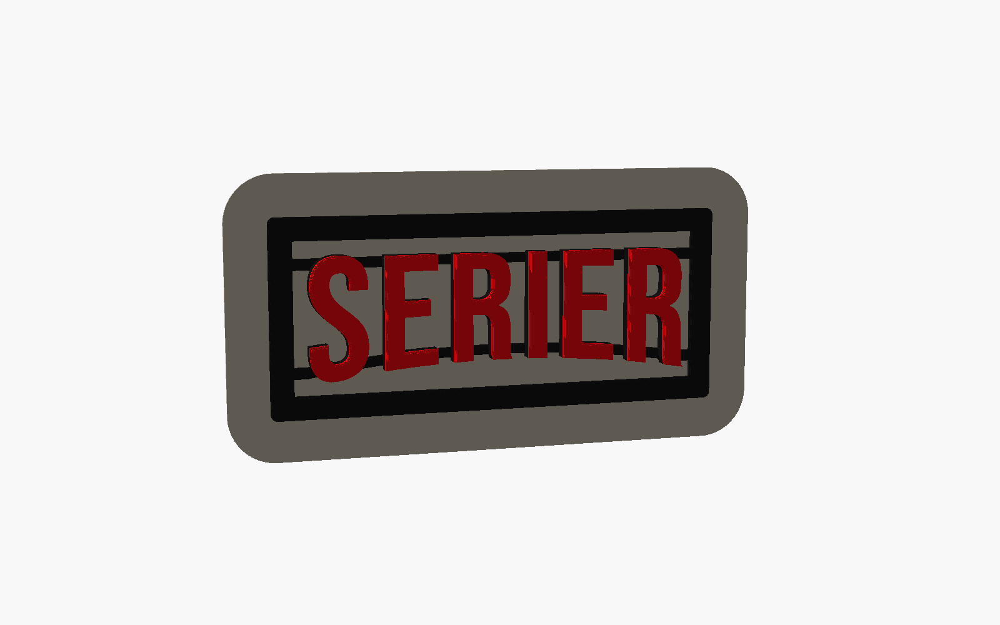
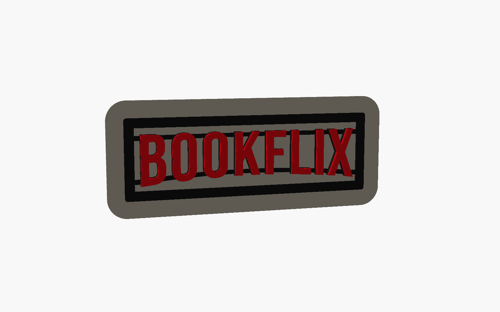

# Streaming-style lettering

An exhibition piece for a school library: `SERIER` in streaming-style bent lettering, and `BOOKFLIX` as a stand and an open frame. SERIER comes in five designs, and every file is ready to print on a Bambu Lab A1 mini or A2L, with an AMS lite for the two-colour parts. Everything is parametric, so a new word, font or size is one setting away.

| | SERIER | BOOKFLIX |
|---|---|---|
| **Stand**: red letters on a black plinth that follows the arc |  |  |
| **Plaque**: black screen with raised letters and a progress bar, in a leaning stand |  | |
| **Loose letters**: chunky two-tone letters for a wall or pinboard |  | |
| **Frame**: the loose letters on a black backing panel with a border, pinned to a pinboard |  | |
| **Open frame**: the same frame without the panel, so the board shows through around and between the letters |  |  |

## Pick a file

Download the project for your product and printer and open it in Bambu Studio. The printer, plates and filaments are already set. For the plates, times and grams of each file, see [`docs/build-summary.md`](docs/build-summary.md).

| Product | A1 mini | A2L | Plates |
|---|---|---|---|
| Stand | [`streaming-lettering-stand-a1-mini.3mf`](https://github.com/edbfi/3d-designs/releases/download/streaming-lettering-latest/streaming-lettering-stand-a1-mini.3mf) | [`streaming-lettering-stand-a2l.3mf`](https://github.com/edbfi/3d-designs/releases/download/streaming-lettering-latest/streaming-lettering-stand-a2l.3mf) | SERIER, then BOOKFLIX: the letters, then the plinth |
| Plaque | [`streaming-lettering-plaque-a1-mini.3mf`](https://github.com/edbfi/3d-designs/releases/download/streaming-lettering-latest/streaming-lettering-plaque-a1-mini.3mf) | [`streaming-lettering-plaque-a2l.3mf`](https://github.com/edbfi/3d-designs/releases/download/streaming-lettering-latest/streaming-lettering-plaque-a2l.3mf) | The plaque, its stand, then an inlay plaque and inlay letters for printing without an AMS |
| Frame | [`streaming-lettering-frame-a1-mini.3mf`](https://github.com/edbfi/3d-designs/releases/download/streaming-lettering-latest/streaming-lettering-frame-a1-mini.3mf) | [`streaming-lettering-frame-a2l.3mf`](https://github.com/edbfi/3d-designs/releases/download/streaming-lettering-latest/streaming-lettering-frame-a2l.3mf) | The letters, then the frame sections |
| Open frame | [`streaming-lettering-open-frame-a1-mini.3mf`](https://github.com/edbfi/3d-designs/releases/download/streaming-lettering-latest/streaming-lettering-open-frame-a1-mini.3mf) | [`streaming-lettering-open-frame-a2l.3mf`](https://github.com/edbfi/3d-designs/releases/download/streaming-lettering-latest/streaming-lettering-open-frame-a2l.3mf) | SERIER, then BOOKFLIX: the letters, then the frame sections |

The loose letters are the letters plate of the frame file.

Finished sizes:

| Design | A1 mini files | A2L files |
|---|---|---|
| Stand | 143 × 30 mm plinth (BOOKFLIX 195 × 30 mm), 42 mm letters, 51 mm tall | 258 × 50 mm plinth (BOOKFLIX 351 × 50 mm), 76 mm letters, 90 mm tall |
| Plaque | 135 × 69 mm, 36 mm letters | 256 × 126 mm, 70 mm letters |
| Loose letters | 75 mm tall, 231 mm wide on the wall | 120 mm tall, 370 mm wide on the wall |
| Frame, open frame | 275 × 119 mm (BOOKFLIX open frame 366 × 119 mm), 75 mm letters | 426 × 176 mm (BOOKFLIX open frame 572 × 176 mm), 120 mm letters |

All files use Bambu PLA Basic, the 0.20 mm Standard profile and the textured PEI plate, with a few tweaks (see [Print settings](#print-settings)). Nothing needs supports. Any PLA works; pick a strong red (the renders use `#E50914`) and a black or charcoal. Load red as filament 1 and black as filament 2; the plaque also uses grey as filament 3, for the bar's track.

The AMS lite makes the two-colour plates: the plaque and the letters of the frames. Without an AMS, the stand's plates and the plaque's inlay plates are one colour each, so they print too.

## Printing and assembly

Every plate is a separate print, so with two printers, send each plate to whichever one is free.

- **Stand**: the letters print in red, face down so the textured plate gives them a crisp front; the plinth prints in black. Push each letter's tab into its pocket; it's a press fit with 0.15 mm clearance per side, and a drop of glue makes it permanent. BOOKFLIX's letters and plinth are longer than the A1 mini's bed, so they lie diagonally across it.
- **Plaque**: with an AMS, print the plaque: the AMS does the black plaque, the red letters and bar, and the grey bar track. The stand is on its own plate: printed together, it would cost an extra colour change on every layer of the red letters. Without an AMS, print the inlay letters in red (the letters and the bar's fill, face down) and the inlay plaque in black, and press each red piece into its pocket (0.15 mm clearance; glue optional). Either way, slide the plaque into the stand's leaning slot.
- **Letters** (frames and loose letters): printed face down: a red face, then a black body. The AMS changes colour once per plate.

### Frames

A frame project has the loose letters and the black frame, printed back down in sections that dovetail together, one per plate.

1. Push the sections together at their dovetails, on a table. A drop of glue makes a joint permanent.
2. Glue each letter into its pocket (superglue works on PLA). The pockets place the letters, so you don't need a template. Every joint runs through a letter: glued across it, that letter holds the sections together.
3. Hold the frame on the pinboard and push a thumbtack or push pin through every hole in the border. The frame is thin there, so a standard pin still reaches well into the board.

On the open frame, two rails hidden behind the letters' top and bottom strokes carry the letters. For long words, the middle sections have no side border, so they come as separate strips; the border dovetails and the glued letters hold them together. It takes letters (Æ, Ø and Å too), digits, spaces, full stops and commas; for other text, use the frame with the backing panel ([why](docs/design-notes.md#printability-decisions)).

### Hanging the loose letters

Print the matching template from [`templates/`](templates) at 100 % scale (no "fit to page"). The A1 mini ones need A3, or A4 tiled; the A2L ones need tiling. Tape it to the wall, then place each letter on its outline. The line above the letters is the flat top edge; keep it level. Double-sided foam tape or poster putty holds the letters well. The model can also add a back recess for tape or magnet sheet (`letters_mount = "recess"`).

## Print settings

The files start from Bambu's stock 0.20 mm Standard profile. What's changed, and why (measurements in [`docs/design-notes.md`](docs/design-notes.md#printability-decisions)):

| Setting | Where | Why |
|---|---|---|
| Painted seams | every part | Each layer's seam is painted onto the part's hidden side. |
| Face down | loose letters, stand letters, plaque inlays | The textured plate gives the visible face a crisp, even finish with no top-surface lines. |
| Lightning infill | loose letters | Only the back needs holding up; the letters come out about 30 % lighter, which helps tape and putty hold them. |
| No prime tower | every file | The A-series printers purge into their chute; on these parts a tower added time and filament for no visible gain. |

Plinths and the plaque stand keep the stock 15 % infill: their weight keeps the display from tipping over.

## Customise

Open `streaming-lettering.scad` in [OpenSCAD](https://openscad.org) and show **Window → Customizer**. Every setting has a comment in the file; the frames take their letters from the loose-letters settings. For ready-to-print projects of your own text, change `PRODUCTS` (and `SIZES` if needed) at the top of [`tools/build.py`](tools/build.py) and rebuild.

On **MakerWorld's Parametric Model Maker**, use [`makerworld/streaming-lettering-makerworld.scad`](makerworld/streaming-lettering-makerworld.scad), not the desktop file. It's generated from the desktop file and tested on MakerWorld.

- **Plates:** its 3MF has two plates, one per printer, in the right colours: stand letters and plinth, plaque and its stand, the loose letters split in two, or a frame's two halves. For a frame, make its letters with `design` set to `letters` and the same text and size.
- **Fonts:** you get MakerWorld's font picker with 500+ Google Fonts; Bebas Neue is among them.
- **Before printing a MakerWorld 3MF:** switch the plate type to **Textured PEI Plate** in Bambu Studio. MakerWorld defaults to Cool Plate, which heats the bed to only 35 °C.

## Rebuilding the print files

```bash
../tools/docker/run.sh python3 tools/build.py --jobs 2                        # everything; CPUS=2 caps the container lower
../tools/docker/run.sh python3 tools/build.py --jobs 2 --only stand --only 'a1-mini$'
../tools/docker/run.sh python3 tools/build.py --list                          # all project keys
```

The repo's shared toolchain in [`../tools/docker/`](../tools/docker) pins OpenSCAD and Bambu Studio. The script exports the parts, lays out and slices every plate with the stock Bambu profiles, and refuses to write a project that fails its checks. It writes the projects to `build/release/`, and regenerates `templates/`, `makerworld/` and the renders and [build summary](docs/build-summary.md) in `docs/`. When a Bambu Studio step fails, its log is in `build/work/<project>/`. Once a change is merged, `../tools/release.sh streaming-lettering` publishes the [release](https://github.com/edbfi/3d-designs/releases/tag/streaming-lettering-latest).

## How the streaming look is made

The reference wordmark uses a proprietary typeface, so this bends **Bebas Neue**, a free font (SIL OFL) with nearly the same letter widths: the top edge stays flat and the bottom follows a parabola, with the middle letters 13.4 % shorter. The measurements and techniques are in [`docs/design-notes.md`](docs/design-notes.md).

## Licence and trademarks

The model, build script and print files are [AGPL-3.0](../LICENSE). The MakerWorld listing ("Streaming-style bent lettering (customizable)", a draft for now) offers the MakerWorld edition under [CC BY-SA 4.0](https://creativecommons.org/licenses/by-sa/4.0/), the closest Creative Commons match to the AGPL's share-alike terms. The fonts in `fonts/` are under the SIL Open Font License 1.1 and belong to their authors (see the `OFL-*.txt` files).

This is an independent design for a school library display. It is not affiliated with or endorsed by any streaming service, and it contains no third-party logos or artwork: the lettering is a free font bent to a similar shape.
