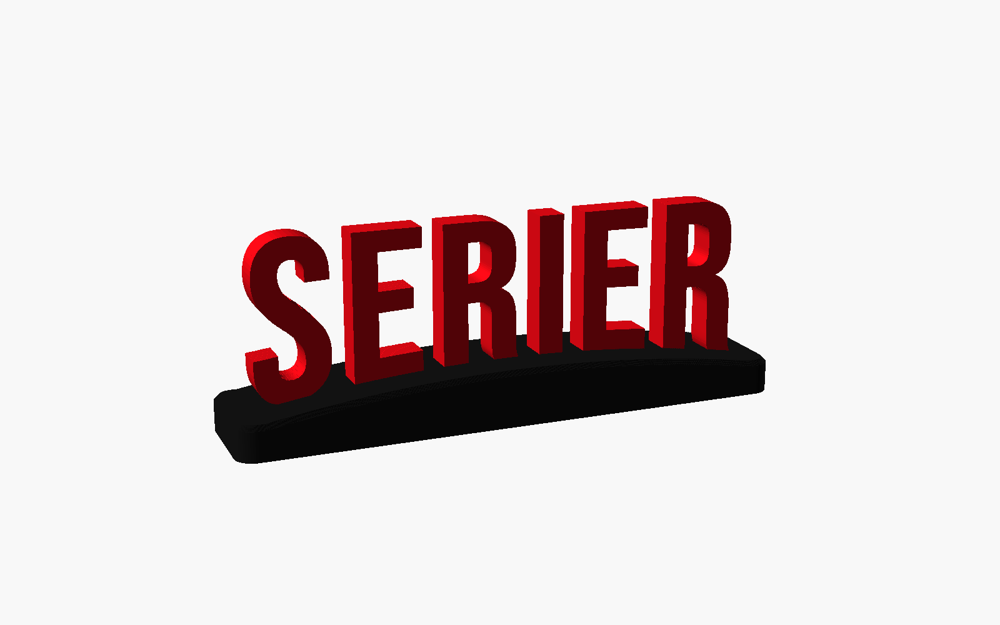
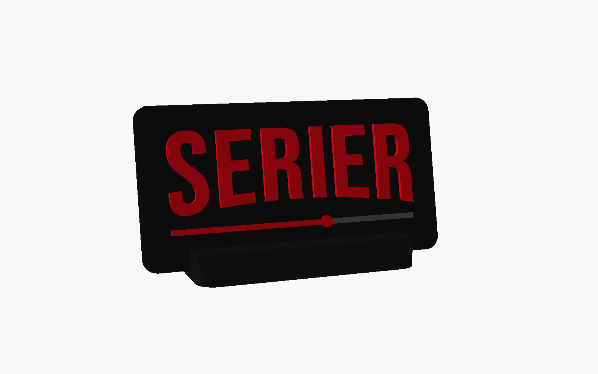
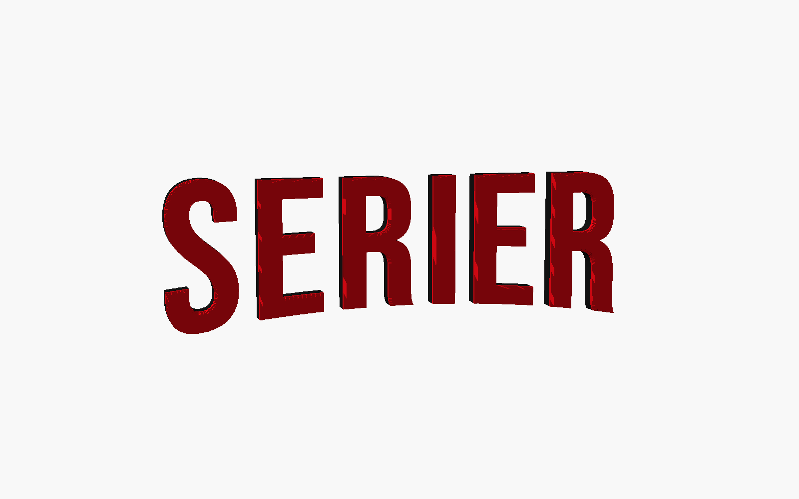

# Streaming-style lettering

An exhibition piece for a school library: `SERIER` in streaming-style bent lettering. It comes in three designs, and every file is ready to print on a Bambu Lab A1 mini (with or without an AMS lite) or an A2L Combo. Everything is parametric, so a new word, font or size is one setting away.

| | SERIER |
|---|---|
| **Stand**: red letters on a black plinth that follows the arc |  |
| **Plaque**: black screen with raised letters and a progress bar, in a leaning stand |  |
| **Loose letters**: chunky two-tone letters for a wall or pinboard |  |

## Pick a file

Open the `.3mf` in Bambu Studio. The printer, plates, filaments, colours and any filament-swap pauses are already set, and every plate is sliced. For the plates, times and grams of each file, see [`docs/build-summary.md`](docs/build-summary.md).

The files come in three sets, each with all three designs:

- **`single-colour/`**: no AMS; every plate prints in one colour. The colours come from separate parts that go together afterwards. This is the simplest option for the two A1 minis.
- **`colour-swap/`**: no AMS; some plates pause once so you can swap between red and black by hand, which gives two-tone parts from one plate.
- **`ams/`**: the AMS lite switches colours by itself, on the A1 mini with an AMS lite or on the A2L Combo (bigger versions).

| Design | Single colour (A1 mini) | Colour swap (A1 mini) | AMS (A1 mini + AMS lite) | AMS (A2L Combo) |
|---|---|---|---|---|
| Stand | [serier](print-files/single-colour/a1-mini/serier-stand-single-colour-a1-mini.3mf) | [serier](print-files/colour-swap/a1-mini/serier-stand-colour-swap-a1-mini.3mf) | [serier](print-files/ams/a1-mini/serier-stand-ams-a1-mini.3mf) | [serier](print-files/ams/a2l-combo/serier-stand-ams-a2l-combo.3mf) |
| Plaque | [serier](print-files/single-colour/a1-mini/serier-plaque-single-colour-a1-mini.3mf) | [serier](print-files/colour-swap/a1-mini/serier-plaque-colour-swap-a1-mini.3mf) | [serier](print-files/ams/a1-mini/serier-plaque-ams-a1-mini.3mf) | [serier](print-files/ams/a2l-combo/serier-plaque-ams-a2l-combo.3mf) |
| Loose letters | [serier](print-files/single-colour/a1-mini/serier-letters-single-colour-a1-mini.3mf) | [serier](print-files/colour-swap/a1-mini/serier-letters-colour-swap-a1-mini.3mf) | [serier](print-files/ams/a1-mini/serier-letters-ams-a1-mini.3mf) | [serier](print-files/ams/a2l-combo/serier-letters-ams-a2l-combo.3mf) |

Finished sizes:

| Design | A1 mini files | A2L Combo files |
|---|---|---|
| Stand | 143 × 30 mm plinth, 42 mm letters, 51 mm tall | 258 × 50 mm plinth, 76 mm letters, 90 mm tall |
| Plaque | 135 × 69 mm, 36 mm letters | 256 × 126 mm, 70 mm letters |
| Loose letters | 75 mm tall, 252 mm wide on the wall | 120 mm tall, 390 mm wide on the wall |

All files use Bambu PLA Matte, the 0.20 mm Standard profile and the textured PEI plate, with a few tweaks (see [Print settings](#print-settings)). Nothing needs supports. Any PLA works; pick a strong red (the renders use `#E50914`) and a black or charcoal.

## Printing and assembly

Every no-AMS project has two plates, so both A1 minis can run at once: in Bambu Studio, send plate 1 to one printer and plate 2 to the other. With one printer, print them one after the other.

### Single colour (no AMS)

- **Stand**: plate 1 is the letters, in red, printed face down so the textured plate gives them a crisp front. Plate 2 is the plinth, in black. Push each letter's tab into its pocket; it's a press fit with 0.15 mm clearance per side, and a drop of glue makes it permanent.
- **Plaque**: plate 1 is the red letters and the progress bar's fill as separate pieces, printed face down. Plate 2 is the black plaque with matching pockets, and its stand. Press each red piece into its pocket (0.15 mm clearance; glue optional), then slide the plaque into the stand's leaning slot.
- **Loose letters**: all red, printed face down, split over two plates.

### Colour swap (no AMS, one manual swap per plate)

- **Stand**: the same two plates as the single-colour set. Change the spool between plates rather than mid-print: the arched plinth has no single layer where black could end, so a one-piece swap isn't possible.
- **Plaque**: plate 1 starts in black and **pauses at 4.2 mm**. On the printer, unload black, load red and resume. The letters and the filled part of the bar come out red; the rest of the bar stays a black groove. Plate 2 is the black stand.
- **Loose letters**: printed face down. Both plates start in red and **pause at 3.2 mm**. Swap to black and resume, which gives black letters with a red face.

### AMS (A1 mini + AMS lite, or the A2L Combo)

No manual swaps. Load red in the slot for filament 1 and black for filament 2. The plaque also uses grey as filament 3, for the bar's track.

- **Stand**: the same two plates as the single-colour set, so each plate is one colour; assemble it the same way.
- **Plaque**: plate 1 is the plaque, plate 2 its stand. Printed together, the black stand would cost an extra colour change on every layer of the red letters.
- **Loose letters**: printed face down: a red face, then a black body. The AMS changes colour once per plate.

### Hanging the loose letters

Print the matching template from [`templates/`](templates) at 100 % scale (no "fit to page"). The A1 mini ones need A3, or A4 tiled; the A2L ones need tiling. Tape it to the wall, then place each letter on its outline. The line above the letters is the flat top edge; keep it level. Double-sided foam tape or poster putty holds the letters well. The model can also add a back recess for tape or magnet sheet (`letters_mount = "recess"`).

## Print settings

The files start from Bambu's stock 0.20 mm Standard profile. What's changed, and why (measurements in [`docs/design-notes.md`](docs/design-notes.md#printability-decisions)):

| Setting | Where | Why |
|---|---|---|
| Painted seams | every part | Each layer's seam is painted onto a hidden side: the backs of the plinths and the plaque stand, the letters' bottom edges, the tabs, the edge that sits in the plaque stand. |
| Face down | loose letters, stand letters, plaque inlays | The textured plate gives the visible face a crisp, even finish with no top-surface lines. |
| Lightning infill | loose letters | Only the back needs holding up; the letters come out about 30 % lighter, which helps tape and putty hold them. |
| No prime tower | every file | The A-series printers purge into their chute; on these parts a tower added time and filament for no visible gain. |

Plinths and the plaque stand keep the stock 15 % infill: their weight keeps the display from tipping over.

## Customise

Open `streaming-lettering.scad` in [OpenSCAD](https://openscad.org) and show **Window → Customizer**. The main settings:

| Setting | What it does |
|---|---|
| `text_string` | The text. Lowercase is turned into capitals (`force_caps`), and spaces and Norwegian letters work |
| `font_name` | Bebas Neue (default, closest to the reference wordmark), Anton (heavier), League Gothic (narrower), or any installed font |
| `letter_height` | Height of the outer letters in mm; the width follows from the text |
| `arc_depth` | How much shorter the middle letters are (0 = straight, 0.134 = reference wordmark) |
| `letter_spacing`, `stroke_weight` | Tighter or looser spacing; bolder or thinner strokes |
| `design` | `stand`, `plaque` or `letters` |
| `part` | `display` for the coloured preview; the other values output one print part laid out for printing |

Each design has its own group of settings: plinth size, chamfers, letter depth, plaque margins, progress-bar fill, stand tilt, mounting recess and so on. Every setting has a comment in the file.

To get your own text into Bambu Studio, you have two options:

- **One part at a time**: set `part` (for example `letters` and then `base` for the stand), press F6 and export each as STL.
- **Whole projects**: edit `TEXTS` (and `SIZES` if needed) at the top of [`tools/build.py`](tools/build.py) and run it (see below). You get the same ready-to-print projects as here, for every printer setup.

On **MakerWorld's Parametric Model Maker**, use [`makerworld/streaming-lettering-makerworld.scad`](makerworld/streaming-lettering-makerworld.scad), not the desktop file. It's generated from the desktop file and tested on MakerWorld.

- **Plates:** its 3MF has two plates, one per printer, in the right colours: stand letters and plinth, plaque and its stand, or the loose letters split in two.
- **Fonts:** you get MakerWorld's font picker with 500+ Google Fonts; Bebas Neue is among them.
- **Before printing a MakerWorld 3MF:** switch the plate type to **Textured PEI Plate** in Bambu Studio. MakerWorld defaults to Cool Plate, which heats the bed to only 35 °C.
- **No pauses:** MakerWorld can't add filament-swap pauses, so the plaque and loose letters need an AMS for two colours. For the no-AMS two-colour versions, use the files in `print-files/`.

The desktop file uses no experimental OpenSCAD features, so it runs in the stock Customizer too.

## Rebuilding the print files

```bash
python3 tools/build.py                                   # everything
python3 tools/build.py --only serier --only 'a1-mini$'   # a subset
python3 tools/build.py --list                            # all variant keys
```

Needs an OpenSCAD snapshot with the Manifold backend (2025 or newer) and Bambu Studio in `/Applications` (tested with 02.08.02.61). On Linux (arm64 or amd64), `tools/docker/` runs the script in a container with both pinned:

```bash
tools/docker/run.sh python3 tools/build.py --jobs 2   # CPUS=2 to cap the container lower (default 3)
```

The script exports the parts, lays out and slices every plate with the stock Bambu profiles, and refuses to write a project that fails its checks. It also regenerates `templates/`, `makerworld/` and the images and [build summary](docs/build-summary.md) in `docs/`. When a Bambu Studio step fails, its log is in `build/work/<variant>/`.

## How the streaming look is made

The reference wordmark uses a proprietary typeface, so this bends **Bebas Neue**, a free font (SIL OFL) with nearly the same letter widths: the top edge stays flat and the bottom follows a parabola, with the middle letters 13.4 % shorter. The measurements and techniques are in [`docs/design-notes.md`](docs/design-notes.md).

## Licence and trademarks

The model, build script and print files are [AGPL-3.0](../LICENSE). The MakerWorld listing ("Streaming-style bent lettering (customizable)", a draft for now) offers the MakerWorld edition under [CC BY-SA 4.0](https://creativecommons.org/licenses/by-sa/4.0/), the closest Creative Commons match to the AGPL's share-alike terms. The fonts in `fonts/` are under the SIL Open Font License 1.1 and belong to their authors (see the `OFL-*.txt` files).

This is an independent design for a school library display. It is not affiliated with or endorsed by any streaming service, and it contains no third-party logos or artwork: the lettering is a free font bent to a similar shape.
